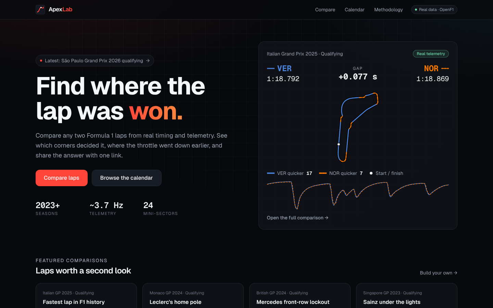
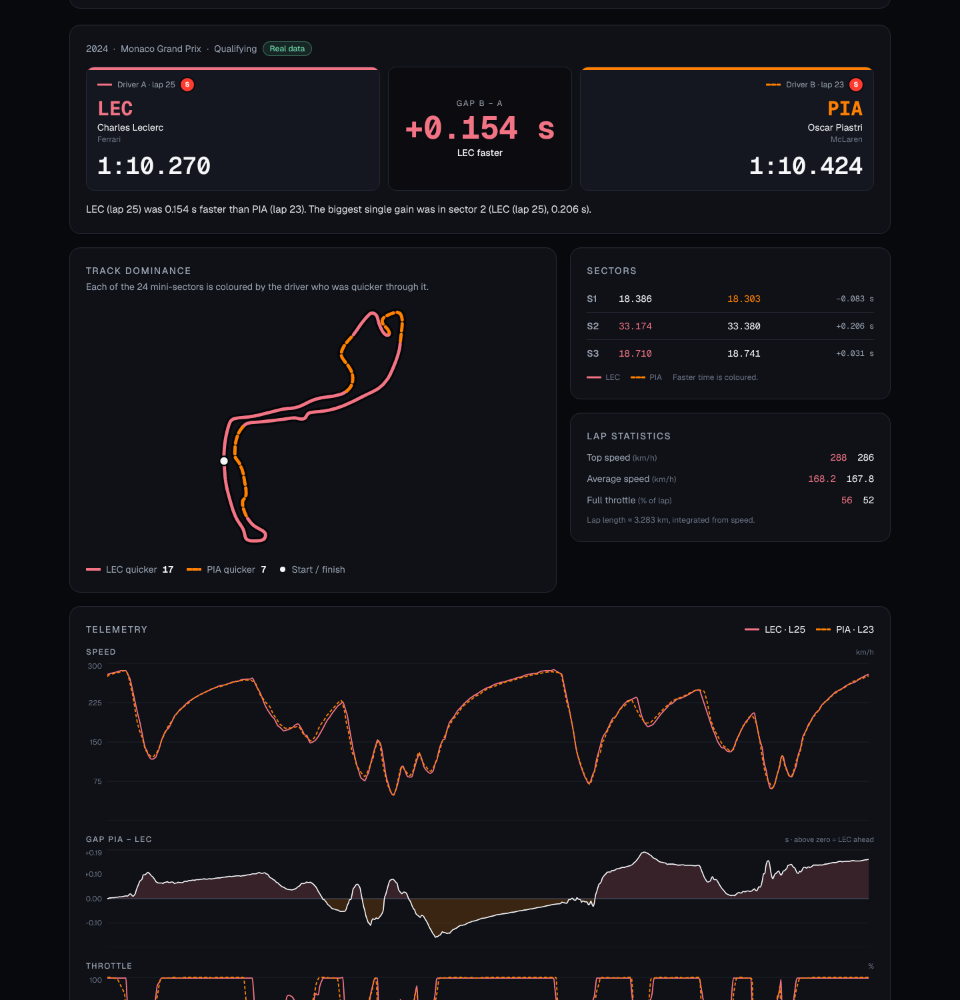
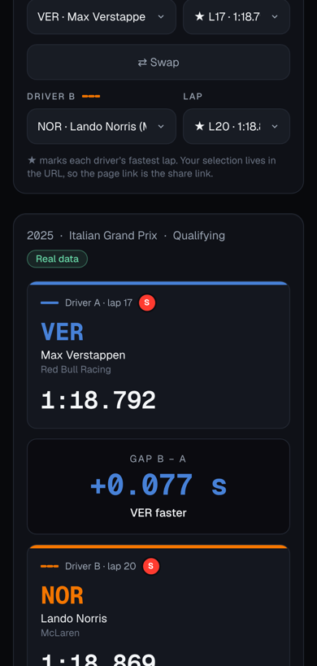
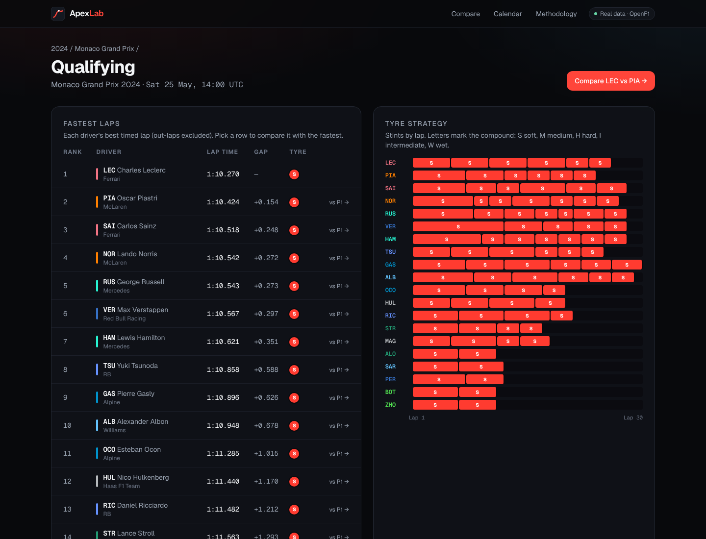
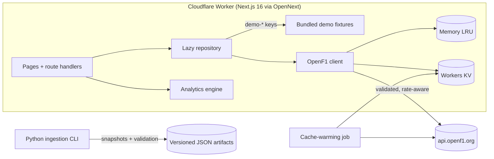

<div align="center">

# ApexLab F1

**The science behind the speed.**

Compare any two Formula 1 laps from 2023 onwards with **real timing and telemetry**.<br/>
See which corners decided it, where the throttle went down earlier, and share the answer with one link.

### [**▶ Live site**](https://apexlab.cou-hackathon.workers.dev) · [Try Monaco 2024: Leclerc vs Piastri](https://apexlab.cou-hackathon.workers.dev/compare?session=9519&a=16&la=25&b=81&lb=23)




</div>

---

## What you can do

| | |
|---|---|
| 🏁 **Compare any two laps** | Pick a season, Grand Prix and session. The two fastest drivers and their best laps load automatically; change anything. |
| 🗺️ **Track dominance map** | The circuit, drawn from car-position data, split into 24 mini-sectors and coloured by whoever was quicker through each. |
| 📈 **Synced telemetry** | Speed, gap, throttle, brake and gear on one distance axis. Hover any chart and all five follow. |
| ⏱️ **Sectors and lap stats** | Sector deltas, top speed, average speed and time at full throttle. |
| 🏆 **Session pages** | A fastest-lap leaderboard with gaps and tyres, plus a tyre-strategy chart for every driver. |
| 🔗 **Share** | The URL *is* the comparison. Every link gets a server-rendered 1200×630 social card with the track outline. |

<table>
<tr>
<td width="68%"></td>
<td width="32%"></td>
</tr>
</table>



## Numbers you can check

The calculations are tested against real results. For Monaco 2024 qualifying, Leclerc's 1:10.270 against Piastri's 1:10.424 gives a gap at the line of exactly **+0.154 s**, and the 24 mini-sector gains sum to **154 ms**.

- **Aligned by distance, not by sample.** OpenF1 has no distance channel, so distance is integrated from speed (the same approach as FastF1). Both laps are then scaled to their mean length, which makes the finish-line gap equal the official lap-time delta.
- **No invented values.** A missing signal stays a gap; it is never drawn as zero.
- **No AI.** The takeaway sentence comes from fixed, documented rules.
- **Every boundary is validated.** Upstream responses, URL parameters and artifacts all go through Zod (TypeScript) or a validator (Python).

Full write-up: [`/methodology`](https://apexlab.cou-hackathon.workers.dev/methodology).

## Architecture



**Engineering highlights**

- **A resilient upstream client** (`packages/openf1`). Requests are queued and spaced, 429/5xx are retried with exponential backoff, and identical in-flight requests are de-duplicated. Long waits fail fast with a clear error.
- **Stale-if-error caching.** Responses live in a memory → KV cache (or memory → disk in dev) with a freshness time. If OpenF1 is rate-limited or down, the last good copy is served instead of an error.
- **Cache warming.** Workers share egress IPs, so cold requests can hit the API's rate limit. `pnpm warm-cache` pre-fills KV from outside Cloudflare using the *same client*, so the keys match exactly.
- **A pure analytics engine** (`packages/analytics`). Normalisation, alignment, mini-sectors and the track map are all dependency-free functions with unit tests.
- **Server-first UI.** The track map is server-rendered SVG with no client JavaScript. Only the interactive charts and selectors are client components.
- **Accessible, and tested for it.** Automated axe checks (WCAG 2 AA) run in CI; they caught and fixed a contrast issue and invalid list markup. Driver identity uses colour *and* line style (solid/dashed), teammates get distinct tints, there's a data-table alternative to the charts, keyboard focus states, and reduced-motion support.

## Tech stack

**Web:** Next.js 16 (App Router), React 19, TypeScript (strict), Tailwind CSS v4, Recharts, Motion, Zod, Geist<br/>
**Data:** OpenF1 REST API, Cloudflare Workers KV, Python 3 ingestion CLI (stdlib only)<br/>
**Infra:** Cloudflare Workers via OpenNext, GitHub Actions CI, pnpm workspaces<br/>
**Quality:** Vitest (33 unit tests), pytest (13), Playwright (24 browser journeys on desktop + mobile, with axe WCAG 2 AA checks), strict type-checking, all in CI

## Repository layout

```
apps/web               Next.js app: pages, API routes, components, Worker entry, cache-warming job
packages/analytics     Pure calculation engine (normalise, align, deltas, mini-sectors, track map)
packages/openf1        Typed OpenF1 client + adapter to ApexLab contracts
packages/contracts     Zod schemas shared by every package
packages/db            Drizzle/PostgreSQL schema + migration (ingestion-side; not in the request path)
services/ingestion     Python CLI: OpenF1 lap snapshots, demo fixtures, artifact validation
data/fixtures/demo     Small synthetic dataset for offline mode and tests
docs/                  Architecture notes, data rights, screenshots
```

## Run it locally

Requires Node 22+ and pnpm 10. Python 3.11+ is optional (only for the ingestion CLI).

```bash
pnpm install
cp .env.example apps/web/.env.local
pnpm dev                     # http://localhost:3000
```

No API key is needed: OpenF1 is free and public. `OPENF1_CACHE_DIR` (set in `.env.example`) caches responses on disk so repeated dev runs stay inside the free rate limit. Set `DATA_SOURCE=fixture` to run completely offline on synthetic demo data.

```bash
pnpm typecheck               # all packages
pnpm test                    # Vitest
pnpm test:py                 # pytest
pnpm e2e                     # Playwright + axe accessibility (offline demo data)
pnpm build                   # production build

# Python: snapshot one real lap into a validated artifact
cd services/ingestion && python3 -m apexlab_ingest.cli openf1 --session 9519 --driver 16 --lap 25
```

## Deploy

```bash
export CLOUDFLARE_API_TOKEN=…   # Workers Scripts: Edit, Workers KV Storage: Edit
export CLOUDFLARE_ACCOUNT_ID=…
pnpm --filter @apexlab/web cf:deploy

# optional: pre-fill the KV cache (calendars, session lists, featured comparisons)
CF_ACCOUNT_ID=… CF_KV_NAMESPACE_ID=… pnpm --filter @apexlab/web warm-cache
```

Details and trade-offs: [`docs/architecture-notes.md`](docs/architecture-notes.md).

## Data and rights

Data comes from [**OpenF1**](https://openf1.org), a free, open-source, unofficial API. ApexLab is a **non-commercial fan project** and is **not affiliated with Formula 1**, the FIA, or any team or driver. It uses no official logos, photography or broadcast material, and has no ads or paid features. See [`docs/data-rights.md`](docs/data-rights.md).
