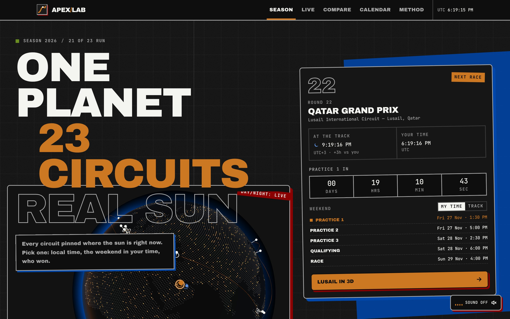
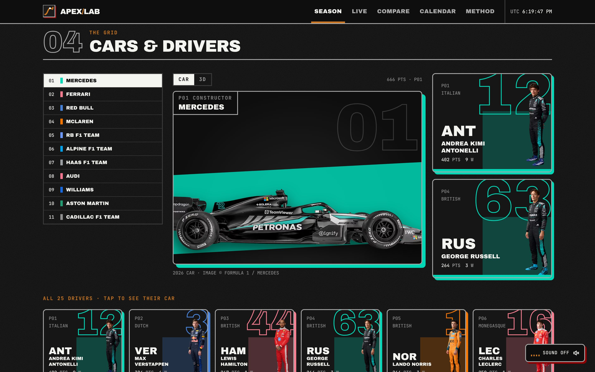
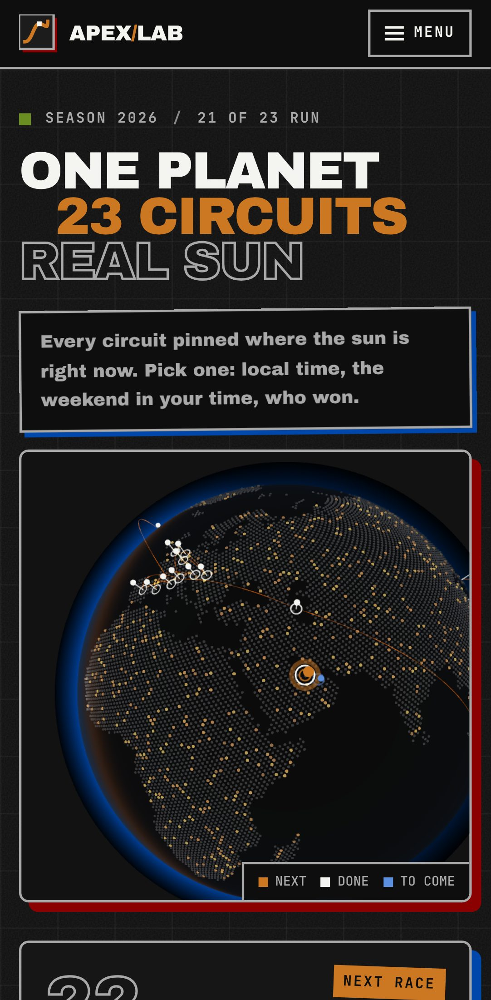
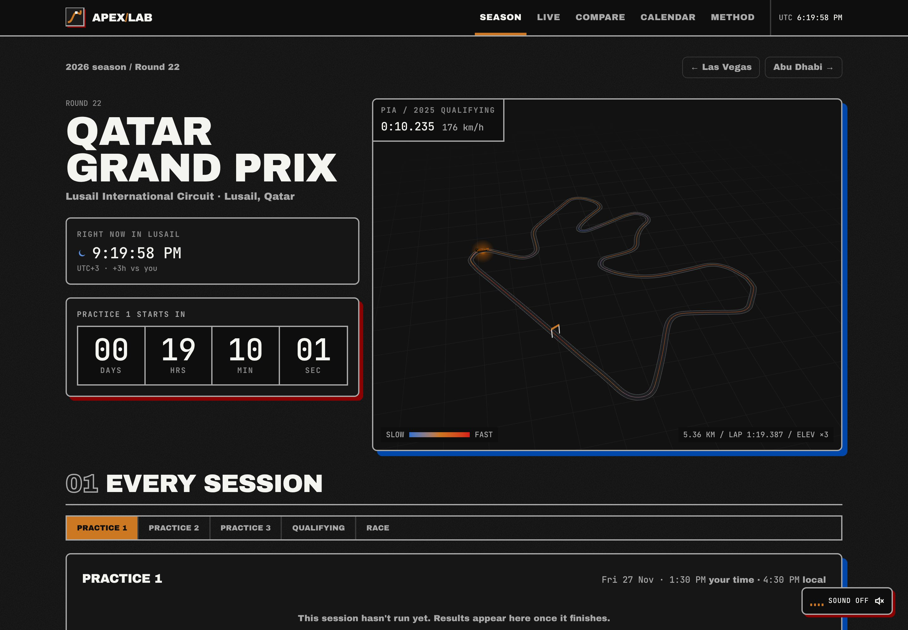
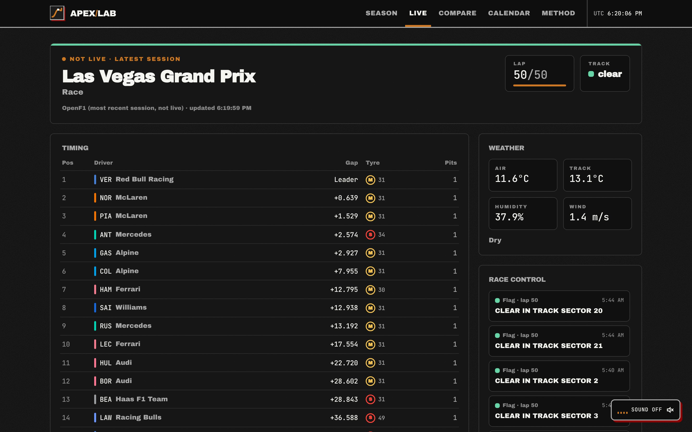
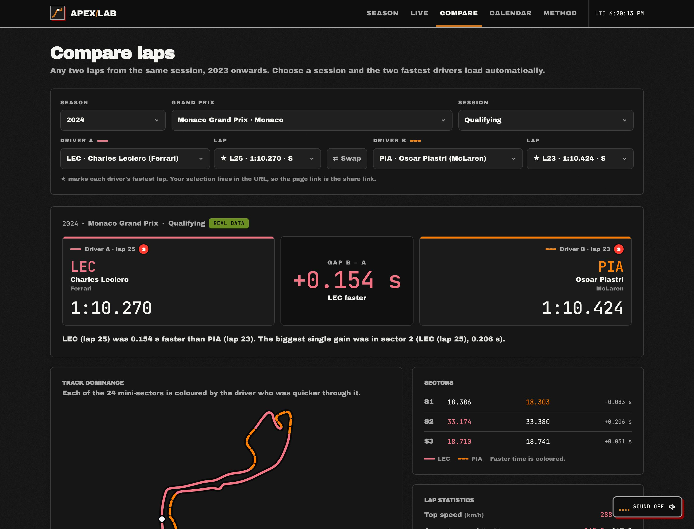
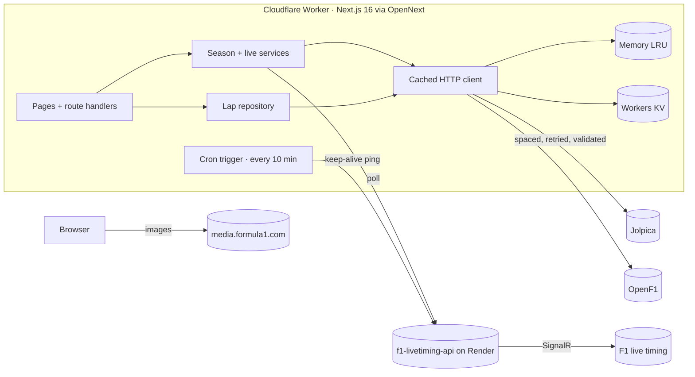

<div align="center">

# APEX/LAB — F1 Season Hub

**The science behind the speed.**

The whole Formula 1 season on one live planet. Countdowns, results from every session, standings,
every circuit in 3D, a live timing dashboard and a lap-by-lap telemetry lab — all in one place.

### [**▶ Live site**](https://apexlab.cou-hackathon.workers.dev) · [Live timing](https://apexlab.cou-hackathon.workers.dev/live) · [Qatar GP in 3D](https://apexlab.cou-hackathon.workers.dev/gp/22?season=2026) · [Monaco 2024: Leclerc vs Piastri](https://apexlab.cou-hackathon.workers.dev/compare?session=9519&a=16&la=25&b=81&lb=23)




</div>

---

## What's inside

| | |
|---|---|
| **3D globe, real sun** | Every circuit pinned on a three.js globe whose day/night line comes from the sun's actual position right now. City lights on the night side, the season route animated as arcs. Click a pin for its local time, its weekend schedule (your time or track time) and who won. |
| **Season hub** | Next-race countdown, the latest podium, driver and constructor standings in team colours, points round by round, and all rounds with their winners. |
| **Cars & drivers** | Official 2026 car renders per team, with a switch to an original procedural **3D race car** on a turntable painted in the team colour, plus a card for every driver with their portrait, race number, points and wins. |
| **Every Grand Prix in 3D** | `/gp/[round]`: the circuit built from real car-position data (real elevation, ×3), a racing line coloured by speed, and a miniature car replaying the pole lap in real time. Tabs for FP1, FP2, FP3, Sprint Qualifying, Sprint, Qualifying and Race. |
| **Live timing** | `/live`: timing tower, gaps, intervals, sectors (purple/green), tyres, pit stops, speed trap, lap count, weather and race control from F1's live feed, refreshed every 3 s during a session. |
| **Telemetry lab** | Compare any two laps since 2023: track dominance map over 24 mini-sectors, synced speed / throttle / brake / gear traces, sector deltas. The URL *is* the comparison, with its own share card. |
| **Soundtrack** | An original racing anthem synthesised live with the Web Audio API (no audio files), behind a mute button. |

<table>
<tr>
<td width="66%"></td>
<td width="34%"></td>
</tr>
</table>



<table>
<tr>
<td width="50%"></td>
<td width="50%"></td>
</tr>
</table>

## Design

Abstract brutalism: an off-black concrete ground (an inline SVG grain, no image), concrete grey, cobalt, oxblood, ochre and moss. Arial Black for display and body (Archivo Black bundled as the open-licence fallback), JetBrains Mono for data. Hard 2px rules, solid offset shadows, a deliberately broken 12-column grid, stepped "distort" hovers, stamped headline entry and scroll reveals. All motion is transform/opacity only and switches off for reduced-motion users. Every clock is 12-hour.

Responsive from 320 px to wide desktop (audited for zero horizontal overflow at 320 / 375 / 768 / 1024 / 1440), with a full-screen menu on phones.

## Data sources

| Data | Source |
|---|---|
| Calendar, session times, race / sprint / qualifying results, standings | [Jolpica](https://github.com/jolpica/jolpica-f1), the community successor to Ergast |
| Practice & sprint-qualifying results, team colours, circuit geometry, telemetry | [OpenF1](https://openf1.org) |
| Real-time timing on `/live` | [f1-livetiming-api](https://github.com/julesr0y/f1-livetiming-api), hosted on Render (`LIVETIMING_API_URL`) |
| Car renders and driver portraits | Formula 1's media CDN, hot-linked (never stored in this repo) |
| Globe land mask | Natural Earth 1:110m (public domain), packed into a 1° bitmask |

Every upstream response is validated with Zod. When a source fails, the page still renders and says what's missing; `/live` falls back to the latest OpenF1 session.

## Architecture



**Engineering highlights**

- **One resilient client for every API** (`packages/openf1`): queued and spaced requests, exponential backoff on 429/5xx (and on Jolpica's 403 burst shedding), de-duplicated in-flight requests, a descriptive User-Agent.
- **Stale-while-revalidate on the edge.** Cached entries are served instantly and refreshed in the background with Workers' `waitUntil`; if an upstream is down, the last good copy is served. Warm pages load in 0.25–1 s.
- **Render never sleeps.** A Cloudflare Cron Trigger pings the free Render instance every 10 minutes, so the live-timing relay keeps its connection to F1's feed.
- **3D without assets.** The globe, circuits and the race car are all built from code with plain three.js: a 10 KB land bitmask, real x/y/z car positions from OpenF1, and a procedural car made of extruded shapes. Rendering pauses off-screen and in hidden tabs.
- **Real astronomy.** The day/night terminator uses a low-precision solar ephemeris; local clocks use IANA zones, so DST is right everywhere.
- **Accessible.** axe (WCAG 2 AA) runs in CI and on real data with zero serious issues; keyboard-operable tabs and globe (via the round list), colour never the only signal, reduced-motion support.

## Tech stack

**Web:** Next.js 16 (App Router), React 19, TypeScript (strict), Tailwind CSS v4, three.js, Recharts, Motion, Zod, Web Audio API<br/>
**Data:** Jolpica, OpenF1, f1-livetiming-api, Cloudflare Workers KV, Python 3 ingestion CLI<br/>
**Infra:** Cloudflare Workers via OpenNext (with Cron Triggers), Render, GitHub Actions CI, pnpm workspaces<br/>
**Quality:** Vitest (45 unit tests), pytest (13), Playwright (36 browser journeys on desktop + mobile with axe), strict type-checking

## Repository layout

```
apps/web               Next.js app: pages, API routes, components, Worker entry (fetch + cron)
  src/components       globe, track-3d, car-showroom, soundtrack, live-dashboard, season sections…
  src/lib              geo/time maths, car model, F1 media URLs, circuits, land mask
  src/server           season (Jolpica + OpenF1), live (f1-livetiming-api), lap repository
packages/analytics     Pure calculation engine (normalise, align, deltas, mini-sectors, track map)
packages/openf1        Cached, typed HTTP client + OpenF1 adapter
packages/contracts     Zod schemas shared by every package
services/ingestion     Python CLI: OpenF1 lap snapshots, demo fixtures, artifact validation
docs/                  Architecture notes, data rights, screenshots
```

## Run it locally

Requires Node 22+ and pnpm 10.

```bash
pnpm install
cp .env.example apps/web/.env.local
pnpm dev                     # http://localhost:3000
```

No API keys are needed. Optional settings in `.env.local`:

| Variable | Purpose |
|---|---|
| `LIVETIMING_API_URL` | Base URL of an f1-livetiming-api instance for real-time `/live` |
| `OPENF1_CACHE_DIR` | Disk cache for dev, keeps repeated runs inside free rate limits |
| `DATA_SOURCE=fixture` | Run fully offline on synthetic demo data |

```bash
pnpm typecheck               # all packages
pnpm test                    # Vitest
pnpm test:py                 # pytest
pnpm e2e                     # Playwright + axe (offline demo data)
pnpm build                   # production build
```

## Deploy

```bash
export CLOUDFLARE_API_TOKEN=…   # Workers Scripts: Edit, Workers KV Storage: Edit
export CLOUDFLARE_ACCOUNT_ID=…
pnpm --filter @apexlab/web cf:deploy
```

`wrangler.jsonc` sets `LIVETIMING_API_URL` and the `*/10 * * * *` cron that keeps the Render instance awake. Render's free plan allows 750 instance-hours a month per workspace — enough for one always-on service.

## Rights

ApexLab is an **unofficial, non-commercial fan project**, not affiliated with Formula 1, the FIA or any team or driver. Car renders and driver portraits are © Formula 1 and the teams, shown by hot-linking from F1's CDN at the owner's decision; the soundtrack is original. Details and the checklist before any commercial use: [`docs/data-rights.md`](docs/data-rights.md).
