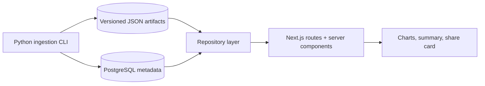

<div align="center">

# ApexLab F1

**The science behind the speed.**

Compare any two laps, see exactly where time is gained or lost, and share the result with a link or a card.

[**Live demo**](https://apexlab.cou-hackathon.workers.dev) · [Quick start](#-quick-start) · [How it works](#-how-it-works) · [Roadmap](#-roadmap)


</div>

> **Unofficial fan project.** ApexLab is not affiliated with, endorsed by, or connected to Formula 1, the FIA, or any team or driver. No official logos, photos or broadcast material are used.
>
> **Demo data only.** Everything in the app is **synthetic**: a fictional circuit, season 2099 and fictional drivers. It is always labelled as demo data and is never a real race result.

---

## ✨ What it does

| | |
|---|---|
| **Compare** | Pick a session, two drivers and a lap each. Get lap times, the overall delta and per-sector deltas. |
| **Explore** | Speed, throttle, brake and cumulative time-delta traces on a shared distance axis, with units, legends, tooltips and a data table. |
| **Share** | Every comparison has a stable URL that restores the exact selection, plus a server-rendered 1200×630 card (copy link or download PNG). |
| **Trust** | Times are integer milliseconds. Telemetry is aligned by distance, never by array index. Missing signals show as gaps or a notice, never as zero. |

The takeaway sentence on each comparison is generated by deterministic rules from the numbers. There is no AI in the loop.

## 🚀 Quick start

Requires Node 22+, pnpm 10 and Python 3.11+ (Python is only needed for ingestion and its tests).

```bash
pnpm install
pnpm dev
```

Open <http://localhost:3000>, choose **Compare laps**, then **Load the demo comparison**. No database or API key is needed.

### Useful commands

```bash
pnpm typecheck     # type-check every package
pnpm test          # Vitest: analytics + contracts
pnpm test:py       # pytest: ingestion
pnpm build         # production build
pnpm fixtures      # regenerate the synthetic demo fixtures (deterministic)
```

### Optional: PostgreSQL mode

Fixture mode is the default. To read metadata from Postgres instead:

```bash
cp .env.example .env            # set DATA_SOURCE=db and DATABASE_URL
pnpm --filter @apexlab/db migrate
pnpm --filter @apexlab/db seed  # idempotent
pnpm dev
```

Telemetry arrays always come from versioned JSON artifacts, never from ordinary relational rows.

## 🧭 How it works



- **Modular monolith.** Next.js serves pages and validated APIs. Python owns ingestion and is kept out of the web runtime.
- **Repository boundary.** The UI and API never touch files or SQL directly, so the data source is swappable (fixtures today, Postgres or rights-cleared data later).
- **Contracts first.** Zod schemas in one package validate artifacts, query strings and API responses.
- **Safe by construction.** Only validated keys reach the data layer, and the client never supplies file paths. Errors use stable codes.

### Sign convention

`delta = Driver B − Driver A`. A positive delta means B's lap took longer than A's.

### API

| Route | Purpose |
|---|---|
| `GET /api/seasons` | Available seasons |
| `GET /api/events?season=` | Events in a season |
| `GET /api/sessions?eventId=` | Sessions for an event |
| `GET /api/sessions/:key/drivers` | Drivers and laps for a session |
| `GET /api/comparisons/data?session&a&la&b&lb` | Chart-ready comparison |
| `GET /api/share-card?…[&download=1]` | Share card PNG |

Errors look like `{ "error": { "code": "VALIDATION_ERROR", "message": "…" } }`.

## 🗂 Repository layout

```
apps/web              Next.js 16 app (App Router, Tailwind v4, Recharts, Motion)
packages/contracts    Zod schemas and shared types
packages/analytics    Pure calculation engine (deltas, distance alignment, summaries)
packages/db           Drizzle schema, SQL migration and seed
services/ingestion    Python CLI: demo source, validation, atomic writes, gated FastF1 stub
data/fixtures/demo    Small synthetic dataset committed to the repo
docs/                 Data-rights checklist and implementation notes
```

Product and engineering specs live at the root: [`PRD.md`](PRD.md), [`architecture.md`](architecture.md), [`Appflow.md`](Appflow.md), [`Schema.md`](Schema.md), [`design.md`](design.md), [`rules.md`](rules.md), [`phases.md`](phases.md), [`Memory.md`](Memory.md).

## ☁️ Deploying to Cloudflare

The app runs on Cloudflare Workers through [OpenNext](https://opennext.js.org/cloudflare).

```bash
export CLOUDFLARE_API_TOKEN=…        # Workers Scripts: Edit
export CLOUDFLARE_ACCOUNT_ID=…
pnpm --filter @apexlab/web cf:deploy
```

Workers has no filesystem, so demo data is bundled into the build (`node scripts/bundle-fixtures.mjs` after regenerating fixtures). Details and caveats are in [`docs/architecture-notes.md`](docs/architecture-notes.md).

## ✅ Status

Phases 1–10 (the local MVP) are built. What has actually been run:

- Vitest (analytics, contracts) and pytest (ingestion) pass.
- Type-check and production build pass.
- API error cases checked with curl; browser smoke test on desktop and a 390 px phone viewport with no console errors.
- Postgres migration applies and re-seeding is idempotent.
- The Workers build was served locally in the Workers runtime before deploying.

Not done yet: a dedicated automated browser-test suite, a keyboard and reduced-motion audit, real FastF1 normalization, a light theme, saved comparisons in the database, and driver pages.

## 🛣 Roadmap

1. **Testing pass:** Playwright journeys, API and failure-case coverage, accessibility checks.
2. **Real data:** resolve the data-rights questions, then finish the FastF1 adapter.
3. **Production hardening:** hosted Postgres, rate limits, cache headers, backups.
4. **Audience:** original analysis pages and privacy-conscious analytics. Ads and monetization only after a content, policy and rights review.

## ⚖️ Data rights

Real F1 data is **not** included and is **not** cleared for public or commercial use. The FastF1 adapter is disabled unless `APEXLAB_ENABLE_FASTF1=1`, and a library licence does not grant rights to the data it fetches. See [`docs/data-rights.md`](docs/data-rights.md) before enabling it.
